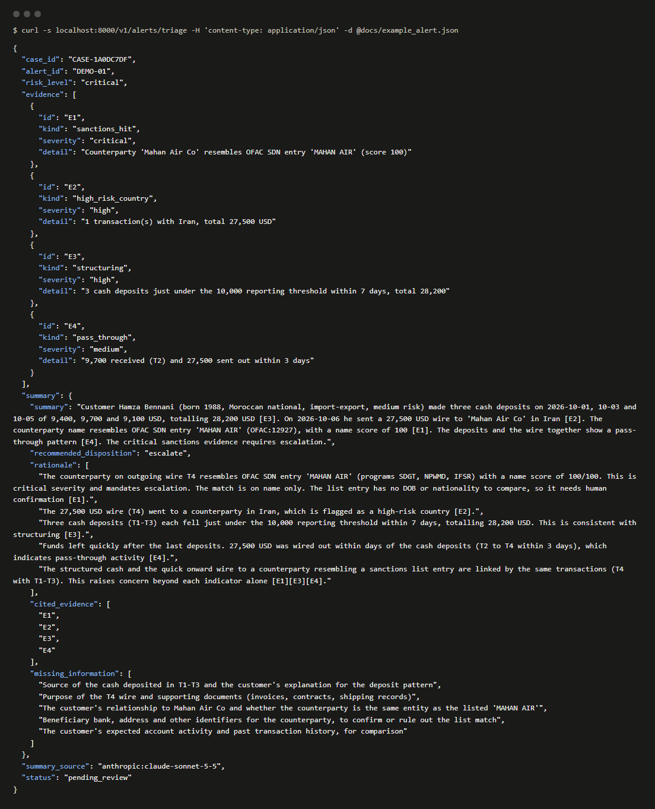

# AML Alert Triage

A first-pass assistant for AML analysts. It takes a transaction-monitoring alert,
screens the customer and every counterparty against sanctions lists, runs the
red-flag rules, and drafts a case summary for a human to decide on. Every step
is written to a tamper-evident audit log.

The design rule: **rules decide, the LLM only explains.** Sanctions hits, risk
levels and red flags are computed deterministically. The model writes the
narrative, must cite the evidence it uses, and its answer is rejected if it
cites evidence that does not exist, recommends closing a case with critical
evidence, or states that someone *is* sanctioned. Nothing leaves "pending
review" without a named analyst.

> **Key result.** Screening 5,000 fictional Moroccan customers against the full OFAC
> SDN + UN lists, on name spellings never used for tuning: same detection as the best
> plain fuzzy search (88.5%) with **2.2x fewer false alerts** (2.8% vs 6.2%), and
> **5x fewer at ~94% detection** (3.4% vs 18.3%). Details and caveats in
> [False alerts on common Moroccan names](#false-alerts-on-common-moroccan-names-real-lists);
> a real case summary is in the [example](#example-one-case-end-to-end).

```
alert ─► screen customer + counterparties (OFAC SDN, UN consolidated list)
      ─► red-flag rules (structuring, pass-through, high-risk countries, profile)
      ─► evidence E1..En  ─► LLM case summary ─► validator ─┬─ ok ─► case (pending review)
                                                            └─ retry, then template fallback
analyst decision ─► audit log (hash-chained, append-only)
```

## What's in it

- **Name screening built for Arabic names** (`triage/names.py`, `triage/matching.py`).
  Romanization variants are folded to one form (Mohamed / Muhammad / Mohd,
  Abdelrahman / Abd al-Rahman, Youssef / Yusuf, Ben Saleh / bin Saleh),
  particles and company suffixes are ignored, and names in Arabic script match
  the lists' original-script field. A first name alone never triggers a hit.
- **Built for full-size lists.** Name parts are weighted by how rare they are in the
  loaded list, so "Mohamed Ali" does not hit every listed person whose longer name
  contains both words, and "Ali Reza Ahmadi" does not hit "Ali Reza Zahedi". OFAC
  birth years and nationalities are read only from their labelled remark fields, so
  passport expiry dates never count as a birth year.
- **Explainable scores.** Each hit lists its name similarity and every
  adjustment: birth year match +5 or mismatch -20, nationality +3 or -10.
  Strong name matches pushed under the threshold by identifiers are kept as
  "discounted" evidence, so the file shows the namesake was considered and why
  it was ruled out.
- **Red-flag rules** (`triage/rules.py`): cash structuring under the reporting
  threshold, funds passed straight through, payments to FATF call-for-action
  countries, high-risk onboarding rating. All thresholds are constants at the top
  of the file.
- **Validated LLM output** (`triage/llm.py`): Pydantic schema, citation checks,
  consistency checks, one retry, then a deterministic template. Works without
  an API key (mock writer) for demos and tests.
- **Audit log** (`triage/audit.py`): SQLite, each row hashed with the previous
  one. UPDATE and DELETE are blocked by triggers; if someone edits the file
  anyway, `GET /v1/audit/verify` reports the first broken row. Model answers,
  rejections, retries and analyst overrides are all logged.
- **Four-eyes on risky closes**: closing a critical case requires a written
  justification; a decided case can't be decided again.

## Example: one case, end to end

A fictional alert ([docs/example_alert.json](docs/example_alert.json)): three cash
deposits just under 10,000, then a 27,500 wire to "Mahan Air Co" in Iran. The
customer is invented; the counterparty is a spelling variant of an entity really on
the OFAC SDN list. Screened against the full OFAC + UN lists, summary written by
Claude (`claude-sonnet-5-5`) and accepted by the validator:



The rules found the four red flags (E1-E4) and set the risk level; Claude only wrote
the text. Every sentence cites its evidence, the counterparty "resembles" a listed
entry rather than "is" sanctioned, and the case waits for an analyst
(`pending_review`). The per-hit details folded in the capture (programs, reasons,
listed identifiers) are in the full response,
[docs/example_case.json](docs/example_case.json).

The first attempt at this capture fell back to the template: thinking tokens count
against `max_tokens`, and a limit of 1,200 cut the JSON short. The audit log recorded
both rejected answers, the limit is now 16,000, and an answer stopped by `max_tokens`
or a refusal is treated as a provider error and retried.

## Results on the bundled test set

20 hand-written alerts in `data/alerts.jsonl` against a **fictional** sample list
(`data/sample_list.json`), covering romanization variants, Arabic script,
namesakes, company-suffix and typo variants, structuring, pass-through and
high-risk-country payments.

```
critical sanctions hits: TP=10 FP=0 FN=0 TN=10
recommended disposition matches label: 19/20
```

The one miss (A03): an exact name match with a birth year 25 years off. The
system recommends closing it as a namesake; the label says "request
information". Both are defensible. This is a sanity check written by the same
person who wrote the rules, not a benchmark.

## False alerts on common Moroccan names, real lists

5,000 fictional customers (random combinations of common Moroccan first and family
names, random birth year, nationality Morocco) screened against the full OFAC SDN +
UN lists (20,602 entries). Since they are invented, every alert is a false alert.
95% intervals in brackets.

**Tuning run (seed 42).** The matcher was adjusted after looking at this run's misses,
so the next two tables show where tuning ended up, not an independent test. The
independent figures are in the held-out check further down.

| | false alerts |
|---|---|
| plain fuzzy search, `token_set_ratio` >= 80 | 21.8% [20.7-22.9] |
| plain fuzzy search, `token_sort_ratio` >= 80 (best simple method) | 5.9% [5.3-6.6] |
| normalization + scoring, name only | 2.6% [2.2-3.1] |
| normalization + scoring + birth year | 1.1% [0.8-1.4] |
| normalization + scoring + birth year + nationality | 0.5% [0.4-0.8] |

**Detection.** 1,200 real listed individuals with Arabic names, altered in ways the
normalizer's variant table does not cover, screened with their listed birth year:

| alteration | best plain fuzzy (`token_sort`) | v1 | current |
|---|---|---|---|
| typo (one letter added, dropped or swapped) | 94.0% | 80.3% | 87.0% |
| middle name dropped | 83.0% | 86.7% | 98.3% |
| word order reversed | 100% | 100% | 100% |
| transliteration not in the variant table (Hacen, Ehmed, Mouhamad...) | 87.0% | 43.7% | 99.3% |
| **all** | **91.0%** | **77.7%** | **96.2%** [94.9-97.1] |

So against the best plain fuzzy search: false alerts 5.9% -> 1.1% (0.5% with
nationality), detection 91.0% -> 96.2%.

The first version (v1) had fewer false alerts (0.4%) but found only 77.7%: a typo or
an unknown transliteration made a name part look rare and missing, and the match was
rejected. What changed:
- name parts are also compared by consonant skeleton (Hacen / Hasan / Hassen -> hsn,
  Youcef / Yusuf -> ysf), with at least three consonants, and a final -i kept
  (Hassani is not Hasan);
- one typo is accepted in name parts of four letters or more;
- a misspelt part takes the rarity weight of the listed part it matches;
- a missing middle name is accepted only when every other part is spelled as listed
  and the birth year matches.

Remaining misses are mostly typos inside particles the normalizer splits ("Abudl",
"Apbdullah"). Remaining false alerts are close namesakes: "Noureddine Idrissi", born
1965, against the UN's "Drissi Noureddine", born 1964, scores 90 even after the
nationality mismatch (Morocco vs Tunisia, -10), so the analyst still sees it.

Limits: the names are invented; these changes were made after looking at the v1
misses on this seed, so the seed-42 figures are not an independent test.

**Held-out check.** Same benchmark, different seed (7), and a second set of
transliterations written after tuning and never used for it (Ahmet, Mukhammad, Halid,
Brahim, Omer, Kassem...):

| | best plain fuzzy (`token_sort`) | current |
|---|---|---|
| false alerts + birth year | 6.2% | 1.3% [1.0-1.6] |
| false alerts + birth year + nationality | 6.2% | 0.5% [0.3-0.7] |
| detection: typo | 93.0% | 85.7% |
| detection: middle name dropped | 79.3% | 98.3% |
| detection: word order reversed | 100% | 100% |
| detection: unseen transliteration | 81.7% | 56.7% |
| **detection: all** | **88.5%** | **85.2%** [83.0-87.1] |

On spellings it was not tuned on, the screener still misses more unknown
transliterations than plain fuzzy search: the consonant skeleton does not cover
final-consonant devoicing (Ahmet / Ahmad, Muhamet), kh / h (Mukhammad, Halid), dropped
initial vowels (Brahim) or names with fewer than three consonants (Omer, Sayeed).

**Same detection, compared.** The table above compares each method at its own default
threshold, where the stricter screener naturally finds less. Sweeping the threshold
from 60 to 95 on the same held-out data, with no retuning, compares them at equal
detection:


| at the detection of plain `token_sort` >= 80 (88.5%) | threshold | detection | false alerts |
|---|---|---|---|
| plain fuzzy, `token_set_ratio` | 89 | 88.8% | 14.3% |
| plain fuzzy, `token_sort_ratio` (best simple) | 80 | 88.5% | 6.2% |
| normalization + scoring + birth year | 71 | 88.6% | 2.8% |
| normalization + scoring + birth year + nationality | 73 | 89.2% | 1.0% |

Same detection as the best simple method, with 2.2x fewer false alerts (6x with
nationality), measured on spellings never used for tuning. The other way round, plain
`token_sort` needs 2.9% false alerts (threshold 82) to match this screener's 85.2% at
its default threshold of 80, where the screener has 1.3%.

The screener's curve is flat above 80: its scores are either high or pushed far down
by the coverage rule, so most of its misses are not near-misses a lower threshold
would recover. Full table: [docs/threshold_curve.csv](docs/threshold_curve.csv).

```bash
python tools/false_alert_benchmark.py --n 5000 --seed 42             # ~30 min on 7 cores, no API key needed
python tools/false_alert_benchmark.py --n 5000 --seed 7 --holdout    # transliterations never used for tuning
python tools/threshold_curve.py --n 5000 --seed 7 --holdout          # threshold sweep, writes docs/threshold_curve.csv
python tools/plot_curve.py                                           # redraws docs/threshold_curve.svg
```

## Run it

```bash
pip install -e ".[dev]"
pytest                      # 30 tests, no API key needed
python evaluate.py          # scores the 20 alerts with the mock writer
python evaluate.py --llm    # same, with Claude writing the summaries (needs ANTHROPIC_API_KEY)

python tools/fetch_lists.py # download OFAC SDN + UN lists into data/ (optional)
uvicorn triage.api:app --port 8000
```

```bash
curl -s localhost:8000/v1/screen -H 'content-type: application/json' \
     -d '{"name": "Mohamed Abdelrahman Kasimi", "dob_year": 1971}'

curl -s localhost:8000/v1/alerts/triage -H 'content-type: application/json' \
     -d "$(sed -n 9p data/alerts.jsonl | python -c 'import sys,json;print(json.dumps(json.load(sys.stdin)["alert"]))')"
```

| Endpoint | |
|---|---|
| `POST /v1/screen` | screen one name, with optional birth year and nationality |
| `POST /v1/alerts/triage` | full triage, returns the draft case |
| `POST /v1/cases/{id}/decision` | analyst decision: escalate, close, request_information |
| `GET /v1/cases/{id}/audit` | every logged event for a case |
| `GET /v1/lists` | loaded list sizes, their age, refresh interval |
| `GET /v1/audit/verify` | checks the whole hash chain |

| Variable | Default | |
|---|---|---|
| `ANTHROPIC_API_KEY` | | enables the Claude writer; mock otherwise |
| `ANTHROPIC_MODEL` | `claude-sonnet-5-5` | |
| `DATA_DIR` | `./data` | real lists are used when present, the sample otherwise |
| `AUDIT_DB` | `audit.sqlite3` | |
| `LIST_REFRESH_HOURS` | `24` | the server re-downloads OFAC + UN lists when older than this and swaps them in without a restart; failures keep the old lists and retry after an hour; `0` turns it off |

Settings can also go in a `.env` file in the project root (git-ignored).

## Not done yet

- Adverse-media search (news screening) as an extra evidence source.
- Case storage is in memory; the audit log is the persistent record.
- The high-risk country list is a constant and must be reviewed after each FATF plenary.
- Arabic-script names only match list entries that publish an original-script
  name (the UN list does, OFAC mostly doesn't); transliterating Arabic script to
  Latin before matching is the next step.

## Layout

```
triage/
  names.py      normalization, romanization variants
  matching.py   screening and explainable scores
  lists.py      OFAC SDN / UN XML / sample loaders
  rules.py      red-flag rules, risk level
  llm.py        prompt, writers, output validator
  service.py    triage pipeline, analyst decisions
  audit.py      hash-chained audit log
  api.py        FastAPI app
evaluate.py     scores data/alerts.jsonl
tools/fetch_lists.py
tools/false_alert_benchmark.py
tools/threshold_curve.py, tools/plot_curve.py
docs/           threshold curve (CSV + SVG)
```

All people and companies in `data/` are fictional.

MIT licensed.
